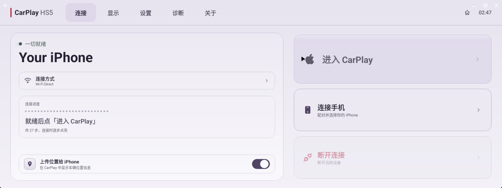
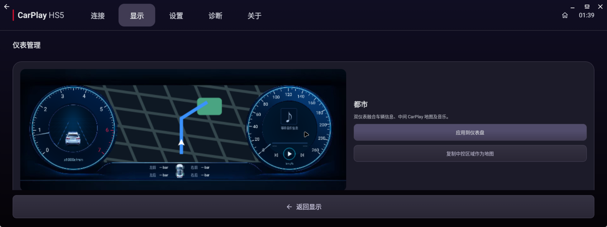

# DiPlay · 红旗 HS5 适配版

**为红旗 HS5 安卓车机适配的 CarPlay / CarLink 手机互联与仪表飞屏项目，基于 DiPlay 开发。**

在原有连接能力上，整合 HS5 车辆数据、方向盘操作、仪表导航与音乐，并提供可自定义的仪表组件。

[界面预览](#界面预览) · [开始使用](#开始使用) · [本地构建](#本地构建) · [HS5 车辆接口](documentation/红旗HS5车辆接口.md) · [项目文档](documentation/README.zh-CN.md)

> 面向红旗 HS5 的启思车机环境开发。不同年款、固件及手机的表现可能不同，不代表支持所有红旗车型或全部安卓车机。本项目与红旗、苹果及 CarLink 相关厂商没有官方隶属关系。

## 主要能力

| 能力 | 说明 |
| --- | --- |
| 手机互联 | 有线、无线 CarPlay；CarLink 接入、手机选择、配对码及分阶段连接进度 |
| 仪表飞屏 | 原始、都市、运动三种风格，显示地图、导航提示、音乐与车辆信息 |
| 原始仪表自定义 | 组件拖动、缩放、旋转、翻转、透明度和层级；可添加多个图片、循环视频组件 |
| 音乐显示 | 封面、歌名、作者、歌词、播放进度；原始风格支持字体、颜色和布局配置 |
| 地图区域 | CarPlay 使用原有地图链路；CarLink 可配置中控画面复制区域，各仪表独立保存 |
| 车辆适配 | 车速、挡位、油量、胎压等；按固件能力接入方向盘、示宽灯与熄屏状态 |
| 日常使用 | 日夜主题、自动连接、车机音频适配及可控诊断日志 |

音乐、歌词和导航信息取决于手机与应用实际下发的数据。CarLink 的画面复制不等同于独立的仪表地图流，也不代表能取得完整导航路线。

## 界面预览

### 夜间主题


### 日间主题



### 仪表配置



### 都市风格仪表


### 运动风格仪表


截图来自项目提供的界面与实车素材；部分为较早界面，具体功能以当前版本为准。

## 开始使用

1. 在允许安装应用的 HS5 安卓车机上安装与固件兼容的安装包，按提示授予必要权限。
2. 在「连接手机」中选择目标手机及 CarPlay / CarLink 协议，再设置实际使用的无线网络方式。协议与无线网络连接方式是两项不同配置。
3. CarPlay 按页面指引建立连接；CarLink 按首页显示的配对码在手机侧确认。手机需支持所选协议。
4. 在「显示 → 仪表管理」选择风格。使用画面复制时，分别为各仪表设置需要显示的中控区域。
5. 需要排查问题时开启诊断日志，复现后保存报告，并记录手机型号、车机固件及发生时间。

连接和仪表显示依赖车机系统服务及权限。模拟器可用于界面预览，不能验证真实车辆数据、方向盘和手机互联的完整行为。仪表附加显示不能替代原车告警。

## 本地构建

本仓库公开项目源码，**不分发 Android 发布签名、签名密码、苹果认证证书或私钥、CarLink 二进制依赖**。当前完整构建仍依赖下列本地文件，仅克隆仓库无法直接生成具备完整连接能力的安装包。

| 本地输入 | 放置位置或配置方式 |
| --- | --- |
| CarLink 编译接口 | `common/libs/icar-sdk-stubs.jar` |
| CarLink 运行代码 | `mobile/libs/icar-sdk-corrected.dex` |
| 预编译本地库 | `mobile/src/main/jniLibs/<架构>/`，包括对应版本的 CarLink 库及配套库 |
| CarPlay 认证材料 | 通过 `DIPLAY_AUTH_ASSETS_DIR` 显式指定本地目录，内含 `offline-mfi/identity.pk8` 与 `offline-mfi/certificate.p7b` |
| 发布签名 | 使用自己的密钥与环境变量，详见[安全与发布说明](documentation/安全与发布.md) |

CarLink 专用二进制须自行取得合法使用授权，仓库不提供下载或授权。其他第三方预编译库仍受各自许可证约束。

构建环境：项目指定的 Java 25 工具链、安卓开发工具包 37、原生开发工具包 `28.2.13676358`，以及可用的 Python 3。使用仓库内的 Gradle 包装器：

```powershell
# 补齐本地依赖后，构建调试版本
.\gradlew.bat :mobile:assembleDebug

# 检查公开源码中是否混入凭据或本地二进制
python scripts/check_public_tree.py
```

未显式提供认证材料的调试包不包含 CarPlay 认证身份。发布构建另有签名指纹、内容封印公钥与完整性校验约束，不能直接套用维护者的发布身份；二次开发应配置自己的签名及相应校验信息。

### 代码结构

| 目录 | 职责 |
| --- | --- |
| `common/` | 页面、HS5 车辆适配、仪表组件及 CarLink 接入 |
| `shared/` | CarPlay 传输、音视频、导航输出和本地代码 |
| `mobile/` | 应用入口、打包与签名流程 |
| `scripts/` | 构建辅助、完整性校验与公开目录检查 |
| `documentation/` | 车辆接口、安全、许可说明及展示截图 |

## 开源声明

本适配版基于 [DiPlay](https://github.com/shihabal3amri/DiPlay) 继续开发，重点补充红旗 HS5 的车辆兼容、CarLink 接入与自定义仪表能力。感谢上游作者及贡献者。

- DiPlay 的连接基础来自 [xcertplay](https://github.com/shilapi/xcertplay)，保留其 GPL-3.0 许可与版权声明，见 [LICENSE](LICENSE)。
- 页面与网站包含基于[DiPlay](https://github.com/shihabal3amri/DiPlay) 的适配内容，这些部分须遵守其 AGPL-3.0 许可，见[许可全文](documentation/DiAuto-AGPL-3.0.txt)。
- 第三方代码、资源与依赖分别遵守原有许可；详见[上游与第三方声明](documentation/上游与第三方声明.md)。源码公开不表示第三方认证材料、闭源组件或商标获得了再分发授权。

使用、修改或分发时，请保留适用的版权、来源和许可证，并履行对应的源码提供义务。本软件免费提供，不提供适用性或持续兼容性保证。项目的免费声明不改变各开源许可证授予的权利。

CarPlay 及其标志属于苹果公司；红旗及其他名称、图标属于各自权利人。项目名称与兼容性描述不代表官方认证或背书。
