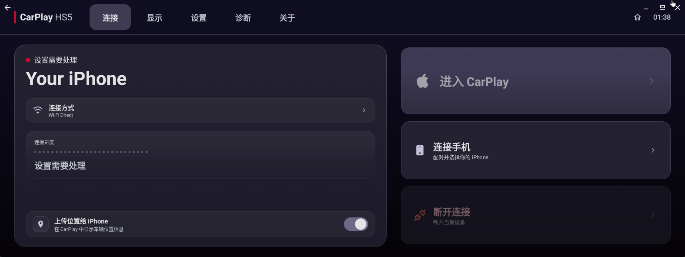
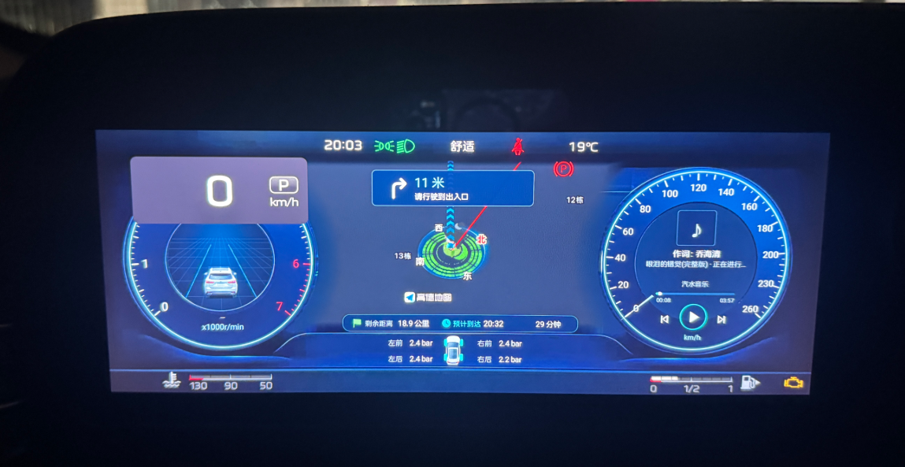
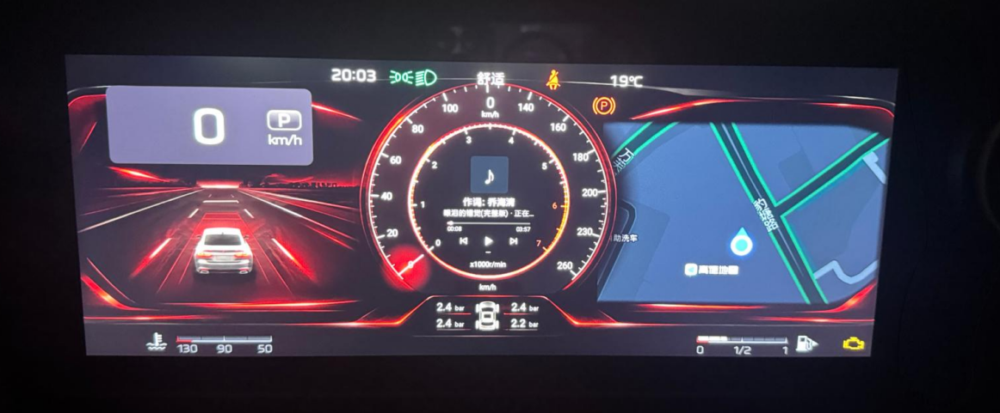

# DiPlay · 红旗 HS5 适配版


在原有连接能力上，整合 HS5 车辆数据、方向盘操作、仪表导航与音乐，并提供可自定义的仪表组件。

[界面预览](#界面预览) · [开始使用](#开始使用) · [本地构建](#本地构建) · [HS5 车辆接口](documentation/红旗HS5车辆接口.md) · [项目文档](documentation/README.zh-CN.md)


## 主要能力

| 能力 | 说明 |
| --- | --- |
| 仪表飞屏 | 原始、都市、运动三种风格，显示地图、导航提示、音乐与车辆信息 |
| 原始仪表自定义 | 组件拖动、缩放、旋转、翻转、透明度和层级；可添加多个图片、循环视频组件 |
| 音乐显示 | 封面、歌名、作者、歌词、播放进度；原始风格支持字体、颜色和布局配置 |
| 车辆适配 | 车速、挡位、油量、胎压等；按固件能力接入方向盘、示宽灯与熄屏状态 |
| 日常使用 | 日夜主题、自动连接、车机音频适配及可控诊断日志 |


## 界面预览

### 夜间主题



### 日间主题


### 仪表配置


### 都市风格仪表



### 运动风格仪表




截图来自项目提供的界面与实车素材；部分为较早界面，具体功能以当前版本为准。

## 开始使用

1. 在允许安装应用的 HS5 安卓车机上安装与固件兼容的安装包，按提示授予必要权限。
2. 在手机选择页面选择要连接的手机，并按页面提示完成 CarPlay 连接。
3. 在「显示 → 仪表管理」选择风格。使用画面复制时，分别为各仪表设置需要显示的中控区域。
4. 需要排查问题时开启诊断日志，复现后保存报告，并记录手机型号、车机固件及发生时间。

连接和仪表显示依赖车机系统服务及权限。模拟器可用于界面预览，不能验证真实车辆数据、方向盘和手机互联的完整行为。仪表附加显示不能替代原车告警。

## 本地构建


| 本地输入 | 放置位置或配置方式 |
| --- | --- |
| CarPlay 认证材料 | 通过 `DIPLAY_AUTH_ASSETS_DIR` 显式指定本地目录，内含 `offline-mfi/identity.pk8` 与 `offline-mfi/certificate.p7b` |
| 发布签名 | 使用自己的密钥与环境变量，详见[安全与发布说明](documentation/安全与发布.md) |


构建环境：项目指定的 Java 25 工具链、安卓开发工具包 37、原生开发工具包 `28.2.13676358`，以及可用的 Python 3。使用仓库内的 Gradle 包装器：

```powershell
# 补齐本地依赖后，构建调试版本
.\gradlew.bat :mobile:assembleDebug

# 检查公开源码中是否混入凭据或本地二进制
python scripts/check_public_tree.py
```

未显式提供认证材料的调试包不包含 CarPlay 认证身份。二次开发者应配置自己有权使用的 CarPlay 认证材料与发布签名。

### 代码结构

| 目录 | 职责 |
| --- | --- |
| `shared/` | CarPlay 传输、音视频、导航输出和本地代码 |
| `mobile/` | 应用入口、打包与签名流程 |
| `scripts/` | 构建辅助与公开目录检查 |
| `documentation/` | 车辆接口、安全、许可说明及展示截图 |

## 开源声明


- DiPlay 的连接基础来自 [xcertplay](https://github.com/shilapi/xcertplay)，保留其 GPL-3.0 许可与版权声明，见 [LICENSE](LICENSE)。
- 第三方代码、资源与依赖分别遵守原有许可；详见[上游与第三方声明](documentation/上游与第三方声明.md)。源码公开不表示第三方认证材料、闭源组件或商标获得了再分发授权。

使用、修改或分发时，请保留适用的版权、来源和许可证，并履行对应的源码提供义务。本软件免费提供，不提供适用性或持续兼容性保证。项目的免费声明不改变各开源许可证授予的权利。

CarPlay 及其标志属于苹果公司；红旗及其他名称、图标属于各自权利人。项目名称与兼容性描述不代表官方认证或背书。
